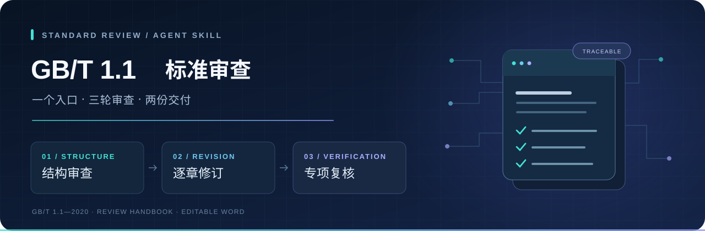

<p align="center">
  
</p>

# GB/T 1.1 标准审查 Skill

[](https://github.com/XYDoctor/gbt11-standard-review/actions/workflows/tests.yml)

**把标准文件交给 Agent，连续完成结构审查、逐章修订和专项复核，交付可核对的审查报告与可编辑的修订稿。**

`gbt11-standard-review` 将 GB/T 1.1—2020 审查工作手册组织为可执行的审查流程。提供仓库网址和文件路径即可发起完整任务，Agent 自动推进各阶段，无需逐轮输入“继续”。

| 审查说明及修改建议 | 修改后的标准文件 |
| --- | --- |
| 问题位置、原文问题、修改建议、依据与处理结果 | 保留原意和技术要求的可编辑 Word 修订稿 |
| 包含覆盖记录、待确认事项与文件检查结果 | 保留原文件，另存新版本 |
| `原文件名_审查说明及修改建议.docx` | `原文件名_修订稿.docx` |

## 一次调用

将下面这段话发给支持读取仓库、访问本地文件和生成 Word 的 Agent，例如具备这些能力的 Codex；替换文件路径即可。

```text
请使用此 Skill 审查并修改标准文件，完成全部流程并交付两份 Word。

Skill：https://github.com/XYDoctor/gbt11-standard-review
标准文件：/你的文件夹/标准草案.docx
```

Agent 应先读取本仓库的 [SKILL.md](SKILL.md) 及其引用的工作手册，再处理指定文件。网址是任务入口；是否安装为常驻 Skill，由所用工具的加载机制决定。

已安装本 Skill 时，可以直接调用：

```text
请使用 $gbt11-standard-review 审查并修改 /你的文件夹/标准草案.docx。
```

如有适用模板、项目要求、专家意见或配套标准原文，一并提供即可。只需审查、只需文字建议或需要修订标记时，在请求中明确说明，Agent 按指定方式交付。

## 自动推进的三轮审查


| 阶段 | 重点 | 工作结果 |
| --- | --- | --- |
| **01 结构审查** | 文件定位、范围、要素顺序、章条层级、引用、术语、图表和附录 | 建立全文清单，定位结构问题 |
| **02 逐章修订** | 按原文逐项审查，修正可确定的问题，保留正确内容 | 在副本中完成修订，记录位置和依据 |
| **03 专项复核** | 能愿动词、列项标点、图表引用、附录性质、术语一致性及文件呈现 | 回查全文，核对修改记录与最终交付 |

长文档可在内部按章分批处理，所有批次连续推进。遇到涉及技术指标、适用范围或约束强度的判断，保留相关原文并列出待确认建议，同时完成其余可确定的修订。

## 每一处修改，都能回到原文

- **定位明确**：记录章条、段落、表格或附录位置，便于对照检查。
- **依据分层**：区分已核实的标准条款、工作手册检查点和编辑建议。
- **技术内容稳定**：保持原意、技术要求和适用范围；“应”改“宜”等影响约束强度的变更单独说明。
- **覆盖过程可查**：记录已审查、已修改、保持原文和待确认的内容，逐条审查不等于逐条改写。
- **交付文件可用**：保留原文件，在修订副本中处理文本，并核对文件内容及可用工具支持的版式呈现。

## 审查内容与使用

本 Skill 以 GB/T 1.1—2020 审查工作手册为核心，将文件定位、结构要素、条款用语、引用、图表和编排要求组织为可重复调用的审查流程，支持输出问题位置、依据和修改建议。

使用时，提供待审稿件、适用模板及项目要求，并按任务配套标准原文和相关编写规则。涉及页面格式、字号字体等具体参数时，参照 GB/T 1.1—2020 附录 E、F 核对。

## 仓库导航

| 文件 | 用途 |
| --- | --- |
| [SKILL.md](SKILL.md) | Agent 执行入口：默认任务、三轮流程、修改原则与完成条件 |
| [标准文本审查工作手册](references/GB_T_1_1_2020_标准文本审查工作手册.md) | 标准结构、条款语言与编排规则的工作清单 |
| [交付约定](references/delivery-contract.md) | 审查报告、修订文件与覆盖记录的交付要求 |
| [文档清点脚本](scripts/docx_inventory.py) | 以 Python 标准库读取 DOCX 内容、哈希和对象，为覆盖记录建立起点 |
| [脚本测试](tests/test_docx_inventory.py) | 验证文档清点脚本的行为 |
| [agents/openai.yaml](agents/openai.yaml) | 支持该配置的工具中的名称、简介和默认调用提示 |

开发时可在仓库根目录运行脚本测试：

```bash
python3 -m unittest discover -s tests -v
```

文档清点脚本提供可追踪的文件清单，具体审查与修改由 Agent 结合工作手册完成。GitHub Actions 在 Python 3.10 和 3.13 上运行脚本测试；顶部状态徽章反映脚本检查结果。

<p align="center"><sub>GB/T 1.1—2020 · Structured Review · Traceable Revision</sub></p>
